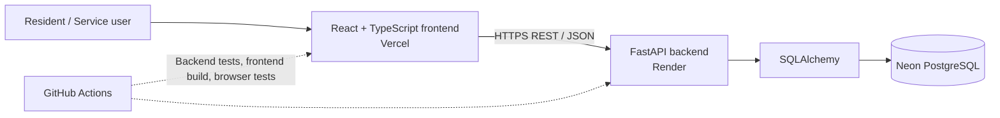

# CivicFlow — Community Service Desk

[](https://github.com/khare-pratham/civicflow/actions/workflows/tests.yml)
[](https://civicflow-xi.vercel.app)

**A full-stack community issue reporting and resolution workflow.** CivicFlow lets residents report local service issues while demonstrating how a service team can triage, prioritise, and track cases through a defined status workflow.

## Live Demo

**[Open CivicFlow](https://civicflow-xi.vercel.app)** · [Backend health check](https://civicflow-api-k362.onrender.com/health) · [Interactive API docs](https://civicflow-api-k362.onrender.com/docs)

CivicFlow is a portfolio MVP with demonstration data. Please do not submit real personal, confidential, or sensitive information.

## At a glance

- Report a community issue with a title, description, category, priority, and location.
- Browse the issue queue and search by issue details or location.
- Filter by status and category.
- View an issue and update its status through the service workflow.
- See an API health indicator that checks backend availability.
- Use a REST API backed by a relational database.

## Screenshots

The live demo is the best way to explore the current interface. Screenshots can be added here as the UI evolves.

## Technology stack

| Layer | Technology |
|---|---|
| Frontend | React 19, TypeScript, Vite |
| UI | Tailwind CSS, DaisyUI, Lucide icons |
| Backend | Python, FastAPI, Pydantic |
| Persistence | SQLAlchemy; PostgreSQL in deployment and SQLite by default for local development |
| Automated tests | pytest, Playwright browser checks, TypeScript/Vite production build |
| CI | GitHub Actions |
| Hosting | Vercel (frontend), Render (API), Neon (PostgreSQL) |

## Architecture



The frontend calls the API over HTTPS. The backend validates requests, applies issue workflow rules, and reads or writes records through SQLAlchemy. The deployed API exposes a health endpoint at `/health` and interactive OpenAPI documentation at `/docs`.

## API overview

| Method | Endpoint | Purpose |
|---|---|---|
| `GET` | `/health` | Check API availability |
| `GET` | `/api/issues` | List issues; supports `status`, `category`, and `q` filters |
| `POST` | `/api/issues` | Create an issue |
| `GET` | `/api/issues/{issue_id}` | Retrieve one issue |
| `PATCH` | `/api/issues/{issue_id}/status` | Update issue status |

Open the [interactive API documentation](https://civicflow-api-k362.onrender.com/docs) to inspect request and response schemas.

## Run locally

### Prerequisites

- Python 3.12 or compatible
- Node.js 22 and npm

### 1. Start the backend

From the repository root:

```bash
python -m venv .venv
```

Activate the virtual environment:

- macOS/Linux: `source .venv/bin/activate`
- Windows PowerShell: `.venv\Scripts\Activate.ps1`

Install dependencies and start the API:

```bash
pip install -r backend/requirements.txt
uvicorn app.main:app --app-dir backend --reload
```

By default, the backend uses a local SQLite database at `civicflow.db`. Set the `DATABASE_URL` environment variable before starting the API if you want to use a different database. Never commit database passwords or production connection strings.

The API runs at `http://127.0.0.1:8000`; docs are available at `http://127.0.0.1:8000/docs`.

### 2. Start the frontend

In a second terminal:

```bash
cd frontend
npm ci
```

Create `.env.local` in the `frontend` directory with:

```dotenv
VITE_API_BASE_URL=http://127.0.0.1:8000
```

Then start the development server:

```bash
npm run dev
```

Open the local Vite URL shown in the terminal, usually `http://localhost:5173`.

## Tests and quality checks

GitHub Actions runs three jobs on pushes and pull requests to `main`:

1. **Backend API tests** — runs pytest.
2. **Frontend production build** — runs the TypeScript check and Vite build.
3. **Frontend end-to-end tests** — launches a local frontend preview and uses Playwright with mocked API responses to exercise key user flows without writing to the live demo database.

Run backend tests locally from the repository root:

```bash
cd backend
pytest -q
```

Build the frontend locally:

```bash
cd frontend
npm ci
npm run build
```

See the [latest CI runs](https://github.com/khare-pratham/civicflow/actions).

## Scope and limitations

CivicFlow is a learning and portfolio project, not a production council platform. The current MVP does not provide user authentication, role-based access control, or a formal audit trail. Demo data is seeded when the database is empty. Do not use it for real service requests or sensitive information.

## Repository

Source code: [github.com/khare-pratham/civicflow](https://github.com/khare-pratham/civicflow)

